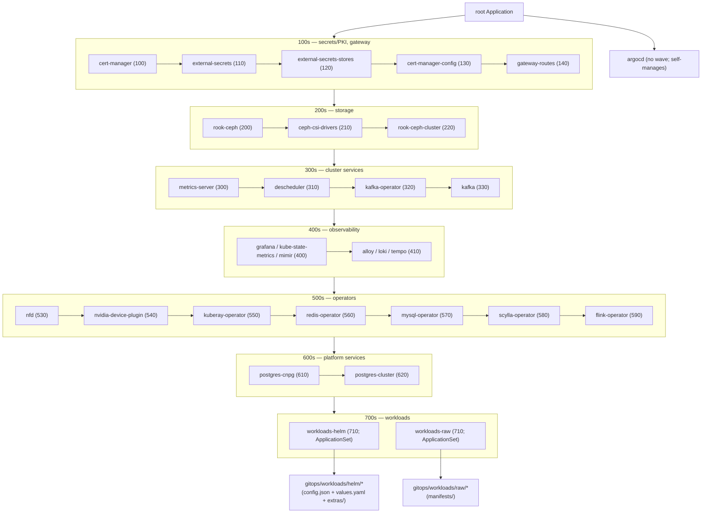

# homelab

Single-cluster Kubernetes homelab on Proxmox. Terraform provisions VMs, Ansible bootstraps the cluster, Argo CD owns everything thereafter.

## Architecture

```
Terraform → Proxmox VMs / disks / cloud-init
   ↓
Ansible  → OS, kubeadm, API VIP, Cilium (full lifecycle), NVIDIA host stack,
           minimal Argo CD + AppProjects, one Vault bootstrap Secret,
           apply root Application (Argo CD then reconciles on its own)
   ↓
Argo CD  → everything else, including its own chart/config
```

### Ownership

- **Terraform** never touches Kubernetes objects.
- **Ansible** owns bootstrap only. It applies the root Application and hands reconciliation to Argo CD, then applies Cilium post-bootstrap features — waiting only for the specific platform resources those features depend on. Platform and workload Applications are otherwise left for Argo CD to reconcile after bootstrap.
- **Argo CD** reconciles all other in-cluster state via the root Application and the workload ApplicationSets. The one deliberate exception is Cilium, which Ansible owns end-to-end.

### Argo CD shape

The root Application (App-of-Apps over `gitops/cluster/applications/`) manages
every node below; arrows show sync-wave order — the root app applies each
wave's child Applications before the next wave's. Waves stagger rollout but do
not gate on child workload health: no `argoproj.io/Application` health
customization is configured, so each child app syncs and retries on its own
schedule once created. Apps sharing a wave are applied concurrently.



ApplicationSet-generated workloads sync concurrently within wave 710. Enabled
workloads come from explicit `elements` lists in `workloads-helm.yaml` and
`workloads-raw.yaml`; commenting out a line disables and prunes that workload.

### Persistent stores

- **HashiCorp Vault** (external) — only persistent source of truth besides Git. Auth via AppRole with `secret_id_ttl=0` and `secret_id_num_uses=0`.
- **Rook-Ceph** — block (`rook-ceph-block`, default), CephFS (`rook-cephfs`, RWX), and an object store consumed through `ExternalSecret`-driven copies of Rook-produced RGW Secrets.
- **CloudNativePG** — three-instance Postgres cluster behind transaction-mode PgBouncer poolers `postgres-cluster-pooler-{rw,ro}.postgres-cluster.svc`. Every application connection goes through a pooler; only admin work (bootstrap Jobs, backup, restore, deployment) connects directly to `postgres-cluster-rw.postgres-cluster`. Airflow, Superset, Hive, Jupyter, Grafana, and Open WebUI create their users/databases with Sync-hook Jobs before the app starts, and Trino creates a read-only `trino` role (`pg_read_all_data`) the same way for its `postgres_*` catalogs; superuser credentials flow from Vault into a `postgres-cluster-superuser` Secret.

### Runtime jar cache

Trino, HDFS, the Hive metastore, and the Spark history server all need jars their images do not ship — the jmx_prometheus agent, the PostgreSQL JDBC driver, hadoop-aws, and the AWS SDK bundle. Those used to be `wget`ed from GitHub Releases and Maven Central on every pod start, which put a public-internet dependency on the data platform's startup path and moved 558 MiB per cold start in the metastore's case.

They now come from a `jars` project on the Harbor instance at `media.xiehang.com`, one OCI artifact per consumer, fetched by an `oras pull` init container:

| Artifact | Contents | Consumers |
| --- | --- | --- |
| `jars/jmx-prometheus-javaagent:1.6.0` | `jmx_prometheus_javaagent.jar` | Trino coordinator + worker, HDFS namenode, Hive metastore |
| `jars/hive-metastore-auxlib:4.2.1` | PostgreSQL JDBC 42.7.13, hadoop-aws 3.4.1, AWS SDK v2 bundle 2.24.6 | Hive metastore |
| `jars/spark-history-s3a:3.3.4` | hadoop-aws 3.3.4, aws-java-sdk-bundle 1.12.262 | Spark history server |

Harbor's proxy-cache projects only mirror OCI registries, and Harbor has no Maven or raw/generic proxy repository, so the original URLs could not simply be repointed at it. Storing the jars as OCI artifacts is the same trick `llm-models` already uses for model weights.

The seeding model is the opposite one, though. `llm-models` self-seeds: its init containers try Harbor, fall back to HuggingFace, and push what they fetched, so the project refills itself and there is no seed script. That works because those pods already hold an HF token, and because the model set is dynamic — it comes from Helm values, so no static list could cover it. Jars are a small fixed set named by manifests in this repo, and self-seeding them would mean Harbor **push** credentials in the Trino, HDFS, Hive, and Spark pods plus keeping the Maven Central URLs around as the fallback path — which is most of the public-internet dependency this exists to remove.

So these init containers are pull-only, with no upstream fallback. The cost is that the cache is not self-healing: an empty or swept `jars` project keeps all four workloads from starting until `scripts/seed-jars.sh` runs again, where `llm-models` would quietly refill itself. That is why seeding is a bootstrap step and why the retention-policy warning below matters.

Operating notes:

- The project and its push robot are created on the media server, the same way `llm-models` and `robot$llm-models+ci` are. This repo consumes them; it does not create them.
- The project must be **public**. Consumers pull anonymously through the normal token flow, so no `ExternalSecret` and no `imagePullSecret` is involved, and nothing in-cluster holds a registry credential. Only `scripts/seed-jars.sh` needs one, from `harbor/jars` in Vault or a `HARBOR_USERNAME`/`HARBOR_PASSWORD` override.
- Do **not** attach a tag-retention policy to this project. Retention rules are what sweep stale image tags elsewhere in Harbor; here every tag is live, referenced by a manifest in this repo, and a swept tag is an outage on the next pod restart. Harbor's garbage collection only reclaims untagged blobs and is safe.
- Filenames inside each artifact are the contract. `oras pull` restores them verbatim, and `METASTORE_AUX_JARS_PATH` plus the `-javaagent` paths in the manifests are written against them.
- Bumping a jar version means a new tag: add it to `scripts/seed-jars.sh`, run the script, then update the manifest reference. Editing a tag in place is not supported — old pods would keep the cached digest.

Spark jobs are a separate case. `spec.deps.packages` and `spark.sql.hive.metastore.jars: maven` resolve Maven coordinates with Ivy inside the driver JVM, which this cache cannot intercept; those still reach Maven Central.

### External monitoring

Alloy scrapes node_exporter on `pi.xiehang.com:9100`, `media.xiehang.com:9100`, and `ai.xiehang.com:9100` every 60 seconds under `job="external/node"`. These hosts have separate resource alerts in `gitops/platform/mimir/extras/rules/external.yaml`; cluster node thresholds do not apply to them. Media provides Vault, Harbor, SSH, and llama.cpp inference; AI also runs llama.cpp inference.

The embedded blackbox exporter checks Vault and Harbor on media, SSH banners on Pi/media/AI, `/health` and a nonempty `/v1/models` list on both inference servers (`https://media.xiehang.com:8443` and `http://ai.xiehang.com:8080`). It also checks Grafana and Argo CD through the gateway, rebuild upstreams, and two internet anchors. Internal probe failures become critical after 10 minutes. The Infrastructure blackbox dashboard shows probe status and latency; the node-exporter dashboard shows Linux host resources. HTTP availability probes do not submit inference requests or prove generation works.

Media runs llama.cpp in router mode on port 8443 with TLS; AI runs it on port 8080 over plain HTTP. Media serves the `deepseek-r1-1.5b-q8` and `qwen3-1.7b-q8` presets, each of which must set `metrics = 1`; AI (macOS) serves `qwen3.8-27b-q8`, `qwen3-1.7b-q8`, `deepseek-r1-1.5b-q8`, and `qwen3-30b-a3b-q4`, with metrics always enabled by `--metrics` in its `run.sh`. Alloy polls each host's `/v1/models` every minute and scrapes only configured models whose state is `loaded`, using `/metrics?model=<id>&autoload=false` under `job="external/llama-cpp"`. Unloaded models and cache-only entries are omitted, and the query parameter prevents a scrape from auto-loading a model during a discovery race. Add new preset IDs to the matching `discovery.relabel` module (`media_llama` or `ai_llama`) in Alloy's values when adding presets. The bare `/metrics` endpoint returns HTTP 400 because it needs a model ID. A loaded model's metrics request may affect llama.cpp's idle timer; verify sleep behavior before enabling sleep-based unloading.

AI also runs a Darwin-compatible node_exporter on port 9100, reachable from cluster nodes (`192.168.0.210-225`). Its memory alert estimates utilisation from total, free, and inactive pages; it does not measure macOS memory pressure. Disk alerts check `/System/Volumes/Data`, since the APFS root snapshot is intentionally read-only. Linux temperature and clock collectors are not assumed to work on macOS. The Infrastructure **AI Host and Inference** dashboard combines AI host CPU, memory, disk, and network with llama.cpp throughput/queue metrics from both inference hosts. Sustained model queues warn after 15 minutes.

### TLS

`cert-manager-config` provisions Let's Encrypt `ClusterIssuer`s (`letsencrypt-prod` + `letsencrypt-staging`) using a Cloudflare DNS-01 solver, then issues `homelab-wildcard-tls` in `gateway-system` for `*.homelab.xiehang.com`. The Gateway terminates TLS on 443; upstream services speak plain HTTP. Every application `HTTPRoute` pins `sectionName: https`, so the port-80 listener serves nothing but the `http-to-https` route in `gateway-system`, which answers every host with a 301 to the same URL over HTTPS. The Cloudflare API token comes from Vault (`cloudflare/api-token`) via an `ExternalSecret`. Browsers trust LE out of the box — no operator-side CA import.

### Network policy

Cilium runs with `enable-policy: default`, so an endpoint is firewalled only once some policy selects it, and only in the directions that policy covers. The cluster is otherwise default-allow. Targeted, ingress-only `CiliumNetworkPolicy` objects protect the services that have no authentication of their own: `open-webui-redis` (no password), the Hive metastore (Thrift, unauthenticated), HDFS (Hadoop simple auth — no Kerberos), and Ray TTS and vLLM (their APIs are checked at the Gateway, so only the Gateway and known callers may reach them). Egress stays unrestricted everywhere.

Ansible owns the Cilium install; Argo CD owns the policy objects, which live beside the component they protect — a workload's `manifests/`/`extras/` or `gitops/platform/<component>/`. Two Cilium behaviours to respect when adding one:

- Allow rules must use pod or namespace selectors. Cilium's CIDR selectors do not match Cilium-managed pod endpoints, so an `ipBlock` allow silently fails closed for in-cluster traffic.
- Allow rules cannot be staged ahead of enforcement. The first ingress policy selecting a pod makes it default-deny for ingress immediately, so a partial allow set is an outage — build the complete set from Hubble first (`kubectl -n kube-system exec ds/cilium -c cilium-agent -- hubble observe --to-pod <ns>/<pod> --follow`), or stage with `enableDefaultDeny.ingress: false` and drop the field once every observed flow has a matching selector.

Gateway traffic arrives with the reserved `ingress` identity, not as a pod in `gateway-system`; kubelet probes need no rule, since the default `allow-localhost: auto` keeps host-sourced traffic forwarded. Ambient-enrolled pods differ on both counts; see [Istio Ambient](#istio-ambient).

### Istio Ambient

Istio 1.31.3 Ambient (`istio-base`, `istiod`, `istio-cni`, `ztunnel`) is installed with mesh-wide `PERMISSIVE` mTLS. A namespace joins with the label `istio.io/dataplane-mode: ambient`; removing the label unenrolls running pods without a restart. Qualification evidence is on #299, phased enrollment on #300.

Adding or removing the label redirects running pods immediately, which breaks connections they already hold. Most clients reconnect, but Ray does not: both Serve replicas crashed within a second either way. For Ray namespaces, flip the label and then restart the RayCluster (delete the head and worker pods); inside the mesh it runs normally.

`ztunnel` pins 2 worker threads and 100 streams per HBONE connection. The stream limit counts over a connection's lifetime: lowering it spreads bulk transfers over more connections but forces a TLS handshake every few new connections (5–10x fewer short-lived requests/s), and a limit of 1 can strand a stream that races a cold pool. Each HBONE connection carries about 0.6 GB/s; a single flow runs about 20% below native TLS and about 70% below plaintext. Keep bulk, many-connection paths on native security (#298).

Before switching a namespace to `STRICT`, list its plaintext callers; under `PERMISSIVE` the destination reports them with `connection_security_policy="unknown"`:

```promql
sum by (source_workload_namespace, source_workload) (
  rate(istio_tcp_connections_opened_total{reporter="destination", destination_workload_namespace="<ns>", connection_security_policy!="mutual_tls"}[1h]))
```

Rolling back is the reverse: delete the `STRICT` `PeerAuthentication`, then remove the namespace label. Both take effect on running pods.

Non-mesh callers of an enrolled workload — the Gateway, its `ExternalAuth` call to Authorino, and kube-apiserver calling a webhook — are rejected under `STRICT`. Give each a workload-selector `PeerAuthentication` with `portLevelMtls` set to `PERMISSIVE` on that one port. An excepted port accepts any plaintext caller, so pair it with a `CiliumNetworkPolicy` that admits only the intended entity (`ingress` or `kube-apiserver`). Every policy selecting an enrolled pod also needs:

- TCP 15008 from `cluster`. Mesh traffic arrives as HBONE on 15008, not on the application port, so a policy listing only application ports breaks every mesh caller.
- `fromCIDR: 169.254.7.127/32` on probe ports and on Gateway-facing ports. Ambient SNATs same-node host-network traffic — kubelet probes, the Gateway's envoy when it runs on the pod's node, any `hostNetwork` pod — to that address. Cilium sees it as `world`, and it bypasses ztunnel and `STRICT` entirely. Limiting it to those ports is the only bound available; it cannot tell kubelet from other host processes.

The mesh does not protect:

- Pods in `kube-system`, `istio-system` and `rook-ceph` (excluded in `istio-cni`) and every `hostNetwork` pod (`kube-system`, `rook-ceph`, `cilium-spire`). Ceph keeps its own msgr2 secure mode.
- UDP, and DNS (capture is off): `kube-dns:53`, Airflow statsd `9125`, and Tempo's chart-default Jaeger agent ports `6831`/`6832` stay plaintext. Nothing here sends to the Jaeger ports; new trace senders should use Tempo's OTLP TCP ports.
- Anything outside the cluster — Vault and Harbor on the media server, HuggingFace, the llama.cpp hosts. Those connections need TLS at the application.

All measurements so far ran between VMs on one physical Proxmox host; they say nothing about physical cross-host traffic.

## First-time bootstrap

End-to-end provisioning of a fresh homelab cluster from this repo plus an external Vault.

### Prerequisites

- Operator workstation with `terraform`, `ansible`, `kubectl`, `helm`, `vault`,
  `jq`, `yq`, `oras`, and `openssl` on PATH.
- Reachable Proxmox cluster, SSH agent loaded with the key used for VM access.
- External HashiCorp Vault reachable at `media.xiehang.com:8200`.
- DNS `*.homelab.xiehang.com` pointed at the Gateway VIP (registered manually post-bootstrap).
- `xiehang.com` zone hosted on Cloudflare, with a scoped API token (`Zone:DNS:Edit` on `xiehang.com` only) ready for cert-manager's DNS-01 solver.
- Public HTTPS access to `https://github.com/hangxie/homelab.git`.
- Harbor at `media.xiehang.com` carrying the `llm-models` project and a **public** `jars` project,
  each with a push robot account. Both are part of media server setup, not this repo — see
  [Runtime jar cache](#runtime-jar-cache).

### Steps

Step 3 also creates the Istio private CA when absent and validates/preserves it on rebuilds. See the [CA rotation commands](#rotate-the-istio-ca) for explicit intermediate renewal and root replacement.

```bash
export VAULT_ADDR=https://media.xiehang.com:8200
export VAULT_TOKEN=...   # operator token with admin perms

# 1. Ensure the KV v2 mount exists so generate:false entries can be pre-loaded.
vault secrets list -format=json | jq -e '."homelab/"' >/dev/null \
  || vault secrets enable -path=homelab -version=2 kv

# 2. Pre-load externally minted credentials (see "Secrets" below).
#    Required because seed-vault.sh refuses to generate placeholders for these.
vault kv put homelab/harbor/llm-models \
  username='robot$llm-models+ci' \
  password='<secret from Harbor>'
vault kv put homelab/harbor/jars \
  username='robot$jars+ci' \
  password='<secret from Harbor>'
vault kv put homelab/huggingface/api-token \
  token='<read token from HuggingFace>'
vault kv put homelab/cloudflare/api-token \
  api-token='<scoped token from Cloudflare>'
vault kv put homelab/slack/mimir \
  webhook-url='<incoming webhook URL from Slack>'
vault kv put homelab/idp/github \
  client-id='<GitHub OAuth app client id>' \
  client-secret='<GitHub OAuth app client secret>'
vault kv put homelab/idp/google \
  client-id='<Google OAuth client id>' \
  client-secret='<Google OAuth client secret>'

# 3. Seed Vault (sets up AppRole/policy and generates random passwords for everything else).
scripts/seed-vault.sh

# 3b. Seed the Harbor jar cache. Init containers in trino/hdfs/hive/spark pull
#     from it at every pod start, so it must be populated before those apps sync.
#     Reads harbor/jars from Vault using the VAULT_TOKEN already exported above.
scripts/seed-jars.sh

# 4. Provision infrastructure.
cd terraform
terraform init
terraform apply
cd ..

# 5. Bootstrap the cluster. This runs the API VIP, kubeadm, Cilium bootstrap,
#    node joins, kubeconfig finalization, NVIDIA host stack, Argo CD,
#    Vault AppRole Secret, root/platform convergence, Cilium post-bootstrap,
#    then Zitadel seeding (waits for Zitadel to come up).
ansible-playbook \
  -i ansible/inventory.ini \
  ansible/bootstrap-k8s.yml

# 6. Point DNS at the Gateway VIP.
#    Add a wildcard A record: *.homelab.xiehang.com -> 192.168.0.219
```

### Secrets

`scripts/seed-vault.sh` auto-generates random passwords for everything except
externally minted credentials marked `generate: false` in
`scripts/vault-secrets.template.yaml`. Those must be written to Vault directly
with the same `VAULT_TOKEN` used for seeding. Current entries:

- `harbor/llm-models` — Harbor robot account used by Ray init
  containers, plus `kubectl homelab model vllm`,
  to manage the model cache.
- `harbor/jars` — Harbor robot account with push on the `jars` project, used by
  `scripts/seed-jars.sh`. Read by the operator only: the project is public and
  the workload init containers pull anonymously, so this never reaches the
  cluster.
- `huggingface/api-token` — HuggingFace read token used by Ray
  model-pull init containers. Anonymous HuggingFace downloads are not allowed.
- `cloudflare/api-token` — scoped Cloudflare API token used by cert-manager's
  DNS-01 solver to issue Let's Encrypt wildcard certs.
- `slack/mimir` — Slack incoming-webhook URL backing the `slack` receiver in
  Mimir's Alertmanager, the target of its root route. Field is `webhook-url`,
  and the value is the full `https://hooks.slack.com/services/T.../B.../...`
  URL. The URL *is* the credential and it also fixes the destination channel, so
  changing channels means minting a new webhook. Create one at
  <https://api.slack.com/messaging/webhooks> (add an app to the workspace →
  Incoming Webhooks → Add New Webhook to Workspace → pick the channel).

  Seed this before the first sync of the `mimir` app: the `mimir-slack`
  ExternalSecret projects it into the Alertmanager pods' environment, and the
  `render-fallback-config` init container substitutes it into the Alertmanager
  config before Mimir starts. A missing Vault path leaves the Alertmanager pods
  stuck in `CreateContainerConfigError`.
- `idp/github`, `idp/google` — OAuth clients for Zitadel's GitHub and Google login providers, fields `client-id` and `client-secret`. Both register the callback URL `https://zitadel.homelab.xiehang.com/idps/callback`. Read by the operator only, through `scripts/seed-zitadel.sh`; see "Single sign-on" below.
- `oidc/<app>` — Zitadel OIDC client for each app in `scripts/zitadel.template.yaml`, fields `client-id` and `client-secret`. Not in `vault-secrets.template.yaml`: Zitadel generates them, and `scripts/seed-zitadel.sh` writes them here.

`seed-vault.sh` generates a private root and signing intermediate. The cluster-readable `istio/ca` entry contains only `ca-cert.pem`, `ca-key.pem`, `root-cert.pem` and `cert-chain.pem`, matching `istio-system/cacerts`. Root material is stored separately at `operator/istio-roots/<SHA-256 root-certificate fingerprint>`; the shared cluster AppRole is explicitly denied data and metadata access under `operator/`. Ordinary seeding validates and preserves it, including with a bare `--regenerate`. Intermediate renewal requires explicitly selecting `istio/ca`; see the [CA rotation commands](#rotate-the-istio-ca).

Re-running `scripts/seed-vault.sh` is idempotent: existing Vault values are kept. `--regenerate` mints fresh values even where Vault already has one, and `--only <path>` narrows the write to named template paths. Template-pinned defaults (usernames) and the `generate: false` credentials above are never touched.

#### Rotate the Istio CA

`seed-vault.sh` creates a missing CA automatically and preserves existing root trust. Routine CA renewal is opt-in and must run alone:

```bash
scripts/rotate-cred.sh --dry-run istio/ca
scripts/rotate-cred.sh istio/ca                 # renew intermediate/key; preserve root
scripts/rotate-cred.sh --rotate-istio-root istio/ca  # replace root too; unenrolled cluster only
```

Renew the one-year intermediate at least 30 days before expiry. Rotation validates the bundle, atomically updates the four-field signing entry with a version guard, verifies all four fields in `cacerts`, then rolls istiod. Default credential rotations skip the CA. The ten-year root lives in an immutable operator-only record addressed by its public certificate fingerprint; use an operator token with access to that record, not the cluster AppRole or a token carrying its deny policy. New roots are stored before publishing their signing bundle, so a failed publication leaves only an unused protected root, not a broken reference. Back up both the signing entry and protected root records.

Previously seeded combined bundles containing `root-key.pem` are refused, not migrated automatically. Before adoption, an operator must preserve the existing root/trust while reseeding the split layout and remove every retained cluster-readable KV version containing the root key; dropping it from the latest version does not remove access to history. Destruction of old versions requires explicit approval and a verified protected backup. If cluster credentials may already have been compromised, treat the root as exposed and plan replacement. Updating Git alone does not change the live Vault policy; rerun seeding with an operator token to install the deny rules.

Root replacement requires typed confirmation, refuses `--yes` and enrolled meshes, and rolls ztunnel after istiod. Confirm no external consumer trusts the old root. An enrolled mesh needs a separately reviewed downtime/trust-distribution plan; do not bypass the gate with the Vault-only seeding option.

On failure, the script prints the previous Vault version. Inspect intervening versions and Secret delivery before retrying; if recovery requires restoring that version, restore the previous four-field signing bundle only while its CA remains valid and uncompromised and its fingerprint-addressed operator root record is retained, force-sync `istio-ca`, verify `cacerts` matches, then roll istiod. Root replacement recovery must restore trust consistently across all consumers. After any rotation, verify fresh workload issuance and representative mesh traffic; Secret delivery and rollout readiness alone do not prove every connection works. `seed-vault.sh --help` and `rotate-cred.sh --help` describe the options.

#### Rotate the auto-generated credentials

`scripts/seed-vault.sh --regenerate` only changes Vault. A new value does not reach a running cluster until the dependent `ExternalSecret` re-syncs, the operator that owns the credential adopts it, the Job that writes the password into its app or database runs again, and the pods holding the old value restart. `scripts/rotate-cred.sh` does all five:

```bash
scripts/rotate-cred.sh --dry-run          # print the plan, change nothing
scripts/rotate-cred.sh                    # every safely rotatable path
scripts/rotate-cred.sh redis/default      # only the named paths
```

It discovers the affected `ExternalSecret`s from the cluster by matching `remoteRef.key` against the rotated Vault paths, so a new workload is picked up with no change to the script. Externally minted credentials (`generate: false`) are refused outright — rotate those at the source with the per-credential steps below.

The operator wait matters for `postgres-cnpg/superuser`: CNPG copies that Secret into the database only when it reconciles, and a cluster reporting healthy will sit on a stale value indefinitely. Every `*-postgres-bootstrap` Job authenticates as that superuser, so without the wait they all fail with `password authentication failed for user "postgres"` while Vault and the Secret both look correct. The script nudges the `Cluster` and waits for `status.secretsResourceVersion.superuserSecretVersion` to match the live Secret before re-running any Job.

Six paths are held back from a bare run because nothing in the cluster re-applies them, or because re-applying them destroys data: `mysql/root`, `cassandra/admin`, `dbeaver/admin`, `openwebui/admin`, `airflow/fernet-key` and `superset/secret`. `scripts/rotate-cred.sh --help` prints the reason for each. Naming one on the command line rotates it anyway and prints the manual step that is now outstanding.

vLLM (`https://vllm.homelab.xiehang.com/v1`, LiteLLM in front of Ray Serve in `ray-vllm`) access:

- **API:** `/v1/*` needs `Authorization: Bearer <PAT>` from a machine user with the `vllm-user` or `admin` role (see API bearer tokens below).
- **Public:** `GET /v1/models` needs no auth: it lists model IDs only.
- **Not exposed:** everything outside `/v1`, including LiteLLM's admin UI and API (`/ui`, `/key`, `/model`, `/config`), has no route.
- **No LiteLLM key:** LiteLLM runs without a master key (`LITELLM_DANGEROUSLY_PERMIT_WEAK_OR_UNSET_MASTER_KEY`, since LiteLLM refuses to boot without one otherwise). The Gateway check and the `ray-vllm` network policy are the only protection, so keep both.
- **Open WebUI:** connects through the Gateway as the `openwebui` machine user (`machines:` in `scripts/zitadel.template.yaml`); its PAT is in Vault `api-keys/openwebui`.

TTS (`https://tts.homelab.xiehang.com/`) access:

- **Login:** the page and `/voices` need a Zitadel login (through OAuth2 Proxy) with the `homelab` project's `admin` or `viewer` role. A session lasts 12h from login.
- **Sign out:** the page has no button; open `https://tts.homelab.xiehang.com/oauth2/sign_out`. It ends both the TTS and the Zitadel session. Logging out of Zitadel elsewhere leaves the TTS session running.
- **API:** `/api` needs `Authorization: Bearer <PAT>` from a machine user with the `tts-user` or `admin` role (see API bearer tokens below).
- **Public:** `/health` and FastAPI's doc routes (`/openapi.json`, `/docs`, `/docs/oauth2-redirect`, `/redoc`) need no auth.
- **First deploy:** run `scripts/seed-vault.sh` (creates `ray/tts-oidc`), then `scripts/seed-zitadel.sh` (registers the `ray-tts` client and writes `oidc/ray-tts`).

API bearer tokens (#254):

- **How it works:** an HTTPRoute rule with an `ExternalAuth` filter asks Authorino (`gitops/platform/authorino`) about each request. Authorino introspects the opaque token at Zitadel, using the `authorino` API client from `apiClients:` in `scripts/zitadel.template.yaml`, and checks the project roles against that API's `AuthConfig`. Results are cached for 60s, so a deleted token or role stops working within a minute.
- **Responses:** an invalid or expired bearer token gets 401 with `WWW-Authenticate: Bearer`, and a valid token without an allowed role gets 403. A request with no `Authorization: Bearer` header never reaches Authorino: it falls through to the page's OAuth2 Proxy, which redirects to the Zitadel login (302). Headless clients that see a 302 forgot the token.
- **Issuing a token:** in the Zitadel console, create a service account (machine user), grant it a `homelab` role (e.g. `tts-user`), and add a personal access token. Hand the PAT to the client. If the account shows as inactive, reactivate it, or its tokens get 401. Console-made machine users are lost on a rebuild; for in-cluster clients, list the account under `machines:` in `scripts/zitadel.template.yaml` instead. `seed-zitadel.sh` then creates it, grants its roles, and keeps a PAT in Vault. Each run checks that PAT against Zitadel and issues a new one when it is missing or revoked, or with `--regenerate`.
- **Rotating a machine PAT:** the script never revokes the old PAT, because consumers hold the token in an env var until they restart. After a new one, run the commands it prints: a force-sync of each ExternalSecret reading the Vault path, and a `rollout restart` of each Deployment/StatefulSet using its Secret (for Open WebUI, `kubectl -n openwebui rollout restart deployment/open-webui`). Check that the consumer works, then delete the old PATs in the Zitadel console.
- **Roles:** grant `*-user` roles to machine users only. Any role passes the project's login check, and Argo CD gives every logged-in user read-only access.
- **Network policy:** a protected backend also needs a `CiliumNetworkPolicy` that only admits the Gateway (`fromEntities: [ingress]`) and its known in-cluster callers, else a pod could call it directly and skip the check (`ray-tts/manifests/networkpolicy.yaml`, `ray-vllm/manifests/networkpolicy.yaml`).
- **Adding an API:** add an `AuthConfig` in `gitops/platform/authorino/`, a `from` entry for its namespace in `03-referencegrant.yaml`, the `ExternalAuth` filter on its route, the network policy, and a `*-user` role in the template.
- **Rotating Authorino's client secret** (`oidc/authorino`, via `seed-zitadel.sh --regenerate`): Authorino reads it only when an AuthConfig reconciles, not when the Secret changes, so every token gets 401 until you run the two commands the script prints. They force-sync the `zitadel-introspection` ExternalSecret, then touch the AuthConfigs (`kubectl -n authorino annotate authconfig --all homelab/reload=$(date +%s) --overwrite`).

DBeaver/CloudBeaver is intentionally not Vault-seeded. It is an internal
admin-only tool, and the first browser login creates the CloudBeaver admin in
the workspace PVC. `kubectl homelab list dashboards` reports that setup step
instead of a Vault-backed credential.

Headlamp is intentionally not Vault-seeded. It uses operator-issued
ServiceAccount tokens (no static credential). The chart provisions the
`headlamp` ServiceAccount and binds it to `cluster-admin`. To log in,
mint a short-lived token against that SA and paste it at the login
screen:

```bash
kubectl -n headlamp create token headlamp --duration=8h
```

`kubectl homelab list dashboards` reports that step instead of a Vault-backed
credential.

OpenWebUI's admin user is seeded by a PostSync `openwebui-admin-bootstrap`
Job that verifies the fixed `admin@homelab.xiehang.com` account with the
Vault-backed password, or calls the signup API on first bootstrap. The first
signup is auto-promoted to admin by OpenWebUI; subsequent signups land in
`pending` (see `DEFAULT_USER_ROLE`) and may be blocked by OpenWebUI's
persisted signup setting. Like Airflow, rotating the Vault password does not
propagate to OpenWebUI on its own — change it in the UI, or wipe the
`open-webui` PVC and let the Job re-seed on the next sync.

#### Rotate Harbor credentials

1. Rotate the robot account in Harbor for the `llm-models` project.
2. Overwrite the Vault entry (a single `kv put` replaces the whole secret):

   ```bash
   vault kv put homelab/harbor/llm-models \
     username='robot$llm-models+ci' \
     password='<new secret from Harbor>'
   ```

3. Force the `harbor-credentials` Secret in the enabled Ray namespaces (`ray-vllm`, `ray-tts`) to refresh from Vault immediately (otherwise wait for the 1h ExternalSecret refresh):

   ```bash
   kubectl -n ray-tts annotate externalsecret harbor-credentials \
     force-sync=$(date +%s) --overwrite
   ```

The `jars` push robot rotates the same way minus step 3 — no workload holds it,
so overwriting `homelab/harbor/jars` is the whole job:

```bash
vault kv put homelab/harbor/jars \
  username='robot$jars+ci' \
  password='<new secret from Harbor>'
```

#### Rotate the Cloudflare API token

1. Mint a new scoped token in the Cloudflare dashboard
   (`Zone:DNS:Edit` on `xiehang.com` only).
2. Overwrite the Vault entry:

   ```bash
   vault kv put homelab/cloudflare/api-token \
     api-token='<new token from Cloudflare>'
   ```

3. Force the `cloudflare-api-token` Secret to refresh:

   ```bash
   kubectl -n cert-manager annotate externalsecret cloudflare-api-token \
     force-sync=$(date +%s) --overwrite
   ```

4. Revoke the old token in the Cloudflare dashboard once cert-manager has
   successfully renewed (`kubectl -n gateway-system describe certificate
   homelab-wildcard`).

#### Rotate the HuggingFace API token

1. Mint a new read token at `https://huggingface.co/settings/tokens`.
2. Overwrite the Vault entry:

   ```bash
   vault kv put homelab/huggingface/api-token \
     token='<new HuggingFace read token>'
   ```

3. Force the `hf-token` Secret in the enabled Ray namespaces (`ray-vllm`, `ray-tts`) to refresh:

   ```bash
   kubectl -n ray-tts annotate externalsecret hf-token \
     force-sync=$(date +%s) --overwrite
   ```

#### Rotate the Slack webhook

1. Mint a new incoming webhook at <https://api.slack.com/messaging/webhooks>.
   Do the same to move alerts to a different channel — the channel is baked
   into the webhook and cannot be overridden from the Alertmanager's side.
2. Overwrite the Vault entry:

   ```bash
   vault kv put homelab/slack/mimir \
     webhook-url='<new incoming webhook URL from Slack>'
   ```

3. Force the `mimir-slack` Secret to refresh, then restart the Alertmanager —
   the URL is baked into the rendered config by an init container at pod start,
   so a Secret refresh alone does not re-point the receiver:

   ```bash
   kubectl -n mimir annotate externalsecret mimir-slack \
     force-sync=$(date +%s) --overwrite
   kubectl -n mimir rollout restart statefulset/mimir-alertmanager
   ```

4. Revoke the old webhook in the Slack app's Incoming Webhooks page.

### Single sign-on

Zitadel (`https://zitadel.homelab.xiehang.com`) is the identity provider. Argo CD deploys it as two apps: `zitadel-config` (wave 640: ExternalSecrets and the database bootstrap Job) and `zitadel` (wave 650: the chart). It connects to `postgres-cluster-rw` directly, not through the pooler.

Zitadel has no config files for login providers or users, so `scripts/zitadel.template.yaml` lists them and `scripts/seed-zitadel.sh` applies it through the API, using the `iam-admin-pat` token that Zitadel's setup Job writes into the `zitadel` namespace. The script is idempotent and runs at the end of `bootstrap-k8s.yml`; run it by hand after editing the template:

```bash
scripts/seed-zitadel.sh   # needs VAULT_ADDR + VAULT_TOKEN and kubectl access
```

- Sign-up: anyone can sign up through GitHub or Google. A first login links by verified email to a user pre-created from the template, or else creates an account with no role grant. The `homelab` project requires a role to log in to any app (`projectRoleCheck`), so a new account can only see its own Zitadel profile until an admin grants `viewer` or `admin` in the console. The script leaves users not in the template alone: removing an entry does not delete the user (delete it in the console), and console-made users and grants are lost on a rebuild.
- Apps: each app is an OIDC client in the Zitadel project `homelab`, listed under `clients:` in the template. A login needs a role grant on the project (`roles:` per user); the roles (`admin`, `viewer`) reach apps as a `groups` list claim, added by the `groupsClaim` Action the script manages (Zitadel's own roles claim is a map most apps cannot read); only grants on `homelab` count, so a role in another project never reaches the claim. The script writes each client's id/secret to Vault `oidc/<app>` when it creates the client, or Vault holds a stale client id or no secret. Zitadel never returns a secret, so a wrong one cannot be detected: `scripts/seed-zitadel.sh --regenerate` mints fresh secrets for all clients and is the recovery. Apps read them through an ExternalSecret, which refreshes hourly, so restart the app after a new secret. Apps keep their local admin login as break-glass where they can run it alongside SSO; kafka-ui, JupyterHub, Superset and Airflow cannot, so they are Zitadel-only.
- Sessions: every login lasts at most 12h. Zitadel cannot end an app's own session, and a Zitadel logout does not revoke refresh tokens, so a logout does not reach apps; instead the template caps tokens (`oidcSettings`) and Zitadel's own login (`loginPolicy`) at 12h, and each app caps its own session at 12h (e.g. Grafana's `login_maximum_lifetime_duration`). Exception: kafka-ui only has a 30m idle timeout. An idle session bounces to Zitadel, so its 12h login still applies, but nonstop use can outlast 12h.
- Revoking access: removing a user's role (`roles:` in the template, then the script) or deactivating the user in the Zitadel console blocks new logins and silent re-logins at once, but apps map roles at login and keep their sessions until their cap. To cut a privileged user off sooner, also end the app session: Grafana (Administration → Users → the user → force logout), Open WebUI (Admin Panel → Users: change role or delete), Superset and Airflow (List Users: remove the role or deactivate the user), JupyterHub (Admin: stop the server and delete the user), kafka-ui (restart the pod; sessions live in memory). Argo CD and Trino validate the token locally, so it stays usable until it expires, at most 12h; Argo CD's local `admin` can still act in the meantime.
- Break-glass: the local `admin` login works when GitHub and Google are down, in Zitadel and, through its `admin` role on `homelab`, in every app. Its password is `homelab/zitadel/admin` in Vault, applied only when Zitadel's database is created. See [Break-glass access](#break-glass-access) for when Zitadel itself is down.
- Rebuild: Zitadel's state lives in Postgres, so a Reset or Nuke loses it; the setup Job and `seed-zitadel.sh` recreate everything from Git and Vault, and provider logins re-link by email.
- `zitadel/masterkey` encrypts Zitadel's data at rest. Never rotate it on a live database; only change it together with a fresh database.

#### Break-glass access

Sessions already open keep working until their cap (12h; kafka-ui until 30m idle). For new logins, pick the case:

**GitHub or Google unreachable, Zitadel up.** Sign in on Zitadel's login page with the local username `admin` instead of a provider button; its password is `homelab/zitadel/admin` in Vault. It holds the `admin` role on `homelab` (`admin.roles` in the template), so every app accepts it through SSO as usual. Nothing to redeploy.

**Zitadel down.** Apps that keep a local login next to SSO need nothing special; `kubectl homelab list dashboards` prints their credentials:

| App | Local login |
|---|---|
| Grafana | the form on the login page |
| Open WebUI | the form on the login page |
| Argo CD | local `admin` (UI or CLI) |
| Trino | password over CLI/JDBC; the web UI is SSO-only |

kafka-ui, JupyterHub, Superset and Airflow are SSO-only and have no stored local password, so a local login is switched on by hand:

1. Stop Argo CD from reverting the change: remove `syncPolicy.automated` from `root` and the app, and for `wl-*` apps first add the app to `ignoreApplicationDifferences` on the `workloads-helm` ApplicationSet (as in AGENTS.md's change workflow).
2. Make up a password for the session (`PW="$(openssl rand -base64 30)"`) and switch the app:
   - kafka-ui: drop the SSO config file and use the form login.
     ```bash
     kubectl -n kafka create secret generic kafka-ui-breakglass \
       --from-literal=SPRING_SECURITY_USER_PASSWORD="${PW}"
     kubectl -n kafka set env deploy/kafka-ui SPRING_CONFIG_ADDITIONALLOCATION- \
       AUTH_TYPE=LOGIN_FORM SPRING_SECURITY_USER_NAME=admin
     kubectl -n kafka set env deploy/kafka-ui --from=secret/kafka-ui-breakglass
     ```
   - Superset: switch FAB to database login and set the `admin` password.
     ```bash
     kubectl -n superset get secret wl-superset-config -o json \
       | jq '.data["superset_config.py"] |= (@base64d | sub("AUTH_TYPE = AUTH_OAUTH"; "AUTH_TYPE = AUTH_DB") | @base64)' \
       | kubectl replace -f -
     kubectl -n superset rollout restart deploy/wl-superset
     kubectl -n superset exec deploy/wl-superset -c superset -- \
       superset fab reset-password --username admin --password "${PW}"
     ```
   - Airflow: the same, in the api-server's `webserver_config.py`.
     ```bash
     kubectl -n airflow get cm wl-airflow-api-server-config -o json \
       | jq '.data["webserver_config.py"] |= sub("AUTH_TYPE = AUTH_OAUTH"; "AUTH_TYPE = AUTH_DB")' \
       | kubectl replace -f -
     kubectl -n airflow rollout restart deploy/wl-airflow-api-server
     kubectl -n airflow exec deploy/wl-airflow-api-server -c api-server -- \
       airflow users reset-password --username admin --password "${PW}"
     ```
   - JupyterHub: the hub reads its config from `values.yaml` in the `hub` Secret.
     ```bash
     VALUES="$(kubectl -n jupyter get secret hub -o json | jq -r '.data["values.yaml"] | @base64d' \
       | PW="${PW}" yq -y '.hub.config.JupyterHub.authenticator_class = "dummy"
           | .hub.config.DummyAuthenticator.password = env.PW
           | .hub.config.Authenticator.admin_users = ["admin"]')"
     kubectl -n jupyter get secret hub -o json \
       | jq --arg v "${VALUES}" '.data["values.yaml"] = ($v | @base64)' \
       | kubectl replace -f -
     kubectl -n jupyter rollout restart deploy/hub
     ```
     Then sign in as `admin` with `${PW}`.
3. When Zitadel is back, re-enable sync on the app and `root` (and drop the ApplicationSet entry). Argo CD restores the SSO config from Git; delete `kafka-ui-breakglass` by hand.

### Verification

```bash
kubectl get applications -n argocd
kubectl get applicationsets -n argocd
kubectl get cephcluster -n rook-ceph
kubectl get certificate -A
kubectl get clustersecretstore vault-homelab
kubectl get nodes -L feature.node.kubernetes.io/pci-0300_10de.present
kubectl -n kube-system exec ds/cilium -- cilium-dbg status --brief
kubectl get cluster -n postgres-cluster postgres-cluster -o jsonpath='{.status.phase}'
```

Browse `https://grafana.homelab.xiehang.com` and `https://argocd.homelab.xiehang.com`.

## Shutting the lab down

Stop the VMs from Proxmox. Nothing needs to be quiesced first.

Every stateful workload here is crash-safe by design — etcd and Ceph journal, Postgres and MySQL replay their logs — so an abrupt power-off costs boot time, not data. MySQL is the one that needs help coming back: roughly every second power-off leaves all three members healthy with Group Replication down, and the operator will not restart it. Both halves of the fix live in `gitops/workloads/raw/mysql/manifests/` — `10-innodbcluster.yaml` keeps the routers from bootstrapping against a group that has not rebooted yet, and `20-outage-reboot.yaml` performs the reboot. Recovery is unattended, within ~6 minutes.

Halting the guests first (`shutdown --halt now`, ~5 min) is fine but buys nothing over a Proxmox stop (<1 min). The VM disks carry no `cache` setting, so they use the PVE default, which honors guest fsync — a stop is no worse than pulling the plug on bare metal.

Don't stop the nodes one at a time over more than five minutes. Taint-based eviction fires at 300s, so a staggered shutdown has the control plane deleting pods on nodes that are already gone, which strands the pod objects as `Unknown` for the kubelet to trip over on the way back up. Killing the whole cluster inside a minute never starts that timer.

## Rebuild modes

Routine changes live in the values files and don't require either of these.

### Reset (cluster broken, VMs fine)

```bash
ansible-playbook -i ansible/inventory.ini ansible/reset.yml
ansible-playbook -i ansible/inventory.ini ansible/bootstrap-k8s.yml
```

Survives: VM identities, IPs, host packages, Vault data, this repo.
Destroys: every byte inside the cluster (Postgres, Ceph, Mimir metrics, Loki logs, Tempo traces, models, etc.).
Time: ~15–20 min Ansible + ~10–15 min Argo CD first-sync.

### Nuke (re-cut from infrastructure up)

```bash
cd terraform && terraform destroy
# edit terraform.tfvars / variables.tf as needed
terraform apply
cd ..
ansible-playbook -i ansible/inventory.ini ansible/bootstrap-k8s.yml
```

Survives: only Vault and Git.
Destroys: VMs, disks, all cluster state.

### What is *not* covered

- Live migration / blue-green cutover.
- In-cluster backup/restore — DR is deferred.
- Partial node replacement while a cluster is healthy — drain, remove the Rook-Ceph OSD, and deregister the node by hand.
- Vault unavailable. The cluster cannot fully converge without Vault; restore Vault from its own backups.

## kubectl plugins

`kubectl-plugins/` contains operator utilities packaged as kubectl plugins.
Symlink them into any directory on your `PATH`:

```bash
mkdir -p ~/.local/bin
for f in kubectl-plugins/kubectl-*; do
  ln -sf "$(pwd)/$f" ~/.local/bin/
done

# Add to PATH if not already present (add to ~/.bashrc or ~/.zshrc to persist)
export PATH="$HOME/.local/bin:$PATH"
```

Verify discovery:

```bash
kubectl plugin list
```

`kubectl homelab -h` lists whatever is installed with a one-line summary of each, and the group commands (`df`, `list`, `model`) list their subcommands the same way. The CLI wrappers (`argocd`, `ceph`, `clickhouse`, `cqlsh`, `hdfs`, `mysql`, `psql`, `redis`, `trino`) pass every argument, `-h` included, straight to the wrapped tool, so `-h` means whatever it means to that tool (`--host` for psql, mysql, redis-cli and clickhouse-client). Each wrapper's namespace/image/host env overrides are listed in its script header. They all run through `kubectl-plugins/lib/oneshot.sh`: piped stdin reaches the tool (`kubectl homelab psql < dump.sql`), output streams for as long as the tool runs, and the plugin exits with the tool's own exit code. Connection defaults come from env vars or a config file written in the pod rather than prepended flags, so a caller's `--user`/`--host` overrides them. The plugins find `lib/` by following their `PATH` symlink back to the repo, so the symlinks must point into a checkout.

| Plugin | Invocation | Purpose |
|---|---|---|
| `kubectl-homelab` | `kubectl homelab [group] -h` | List the installed homelab plugins, or one group's subcommands |
| `kubectl-homelab-argocd` | `kubectl homelab argocd [argocd-args...]` | Run the `argocd` CLI from a one-shot pod, logged in with the live admin secret |
| `kubectl-homelab-ceph` | `kubectl homelab ceph [ceph-args...]` | Run the `ceph` CLI from a one-shot pod, credentials read live from Rook's own Secret/ConfigMap |
| `kubectl-homelab-ceph_s3` | `kubectl homelab ceph-s3 ls [<bucket>[/<prefix>]]` | List Ceph RGW buckets and their contents from a one-shot pod, namespace and credential Secret picked from the bucket name |
| `kubectl-homelab-clickhouse` | `kubectl homelab clickhouse [clickhouse-client-args...]` | Run `clickhouse-client` from a one-shot pod, credentials read live from clickhouse-credentials |
| `kubectl-homelab-cqlsh` | `kubectl homelab cqlsh [cqlsh-args...]` | Run `cqlsh` against the ScyllaDB client service from a one-shot pod (Scylla runs without auth) |
| `kubectl-homelab-df-bucket` | `kubectl homelab df bucket [storage-class]` | RGW bucket usage for ObjectBucketClaims in a bucket storage class |
| `kubectl-homelab-df-pvc` | `kubectl homelab df pvc <storage-class>` | Disk usage for all PVCs in a storage class |
| `kubectl-homelab-hdfs` | `kubectl homelab hdfs [hdfs-args...]` | Run the `hdfs` CLI from a one-shot pod, using the cluster's own core-site/hdfs-site config |
| `kubectl-homelab-list-dashboards` | `kubectl homelab list dashboards` | All HTTPRoute URLs with credentials |
| `kubectl-homelab-model-vllm` | `kubectl homelab model vllm verify\|list\|delete` | Manage vLLM models on PVC and Harbor |
| `kubectl-homelab-mysql` | `kubectl homelab mysql [mysql-args...]` | Run the `mysql` CLI as root from a one-shot pod, credentials read live from mysql-root |
| `kubectl-homelab-psql` | `kubectl homelab psql [psql-args...]` | Run `psql` against the postgres-cluster rw service from a one-shot pod, superuser password read live from postgres-cluster-superuser |
| `kubectl-homelab-redis` | `kubectl homelab redis [redis-cli-args...]` | Run `redis-cli` against the write master from a one-shot pod, credentials read live from redis-default |
| `kubectl-homelab-trino` | `kubectl homelab trino [trino-args...]` | Run the `trino` CLI from a one-shot pod, credentials read live from trino-credentials |

## Repo layout

- `terraform/` — Proxmox VMs, disks, cloud-init, and generated `ansible/inventory.ini`; passes `kube_api_vip` to Ansible.
- `ansible/` — kubeadm, API VIP, Cilium, NVIDIA host stack, minimal Argo CD + AppProjects, Vault bootstrap Secret, root Application, and Cilium post-bootstrap.
- `gitops/cluster/` — root Application and per-component Application/ApplicationSet manifests.
- `gitops/platform/` — Helm values and supporting CRs for platform components.
- `gitops/workloads/helm/<name>/` — `config.json` (`chart_repo`, `chart_name`, `chart_version` only; validated by `gitops/workloads/.schema.json`), `values.yaml`, `extras/` (ExternalSecrets, init Jobs, HTTPRoutes).
- `gitops/workloads/raw/<name>/` — `manifests/` of raw YAML.
- `scripts/` — operator utilities (Vault seed/nuke, certificate seeding, Harbor jar seeding, redeploy).
- `kubectl-plugins/` — kubectl plugins for cluster inspection and model cache management (see [kubectl plugins](#kubectl-plugins)).
